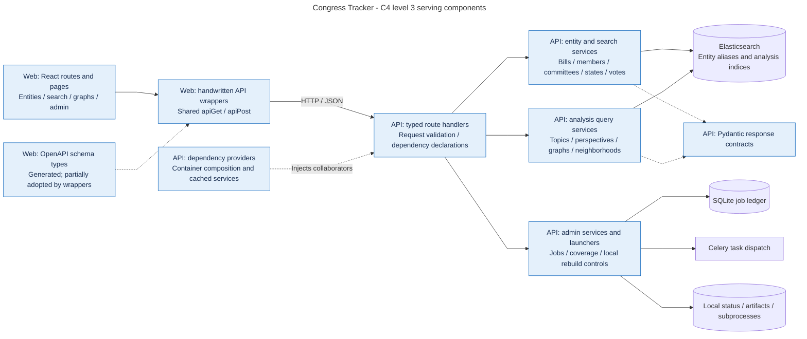
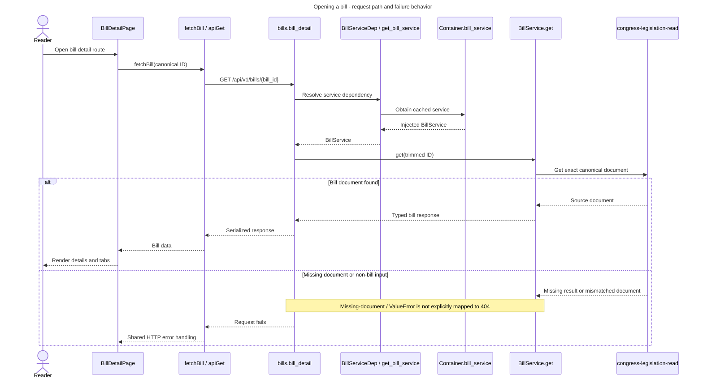
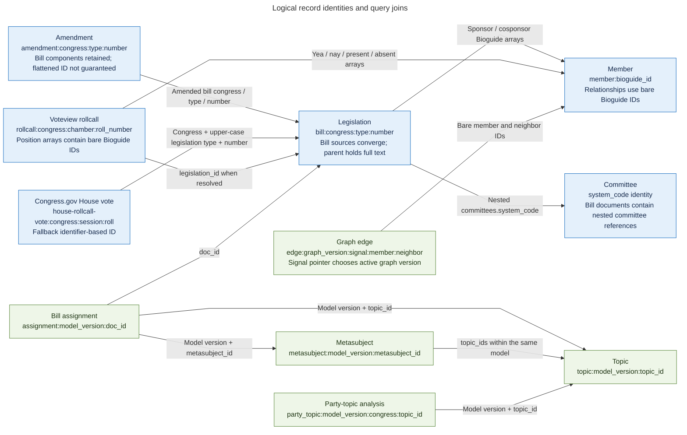
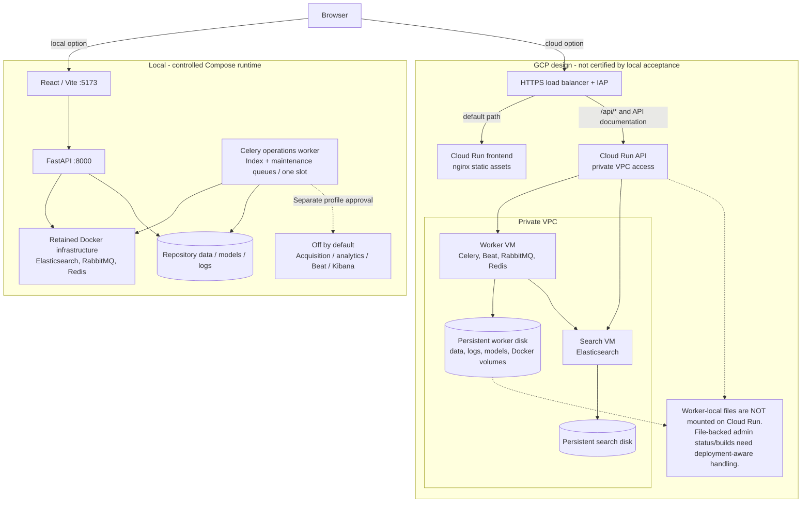
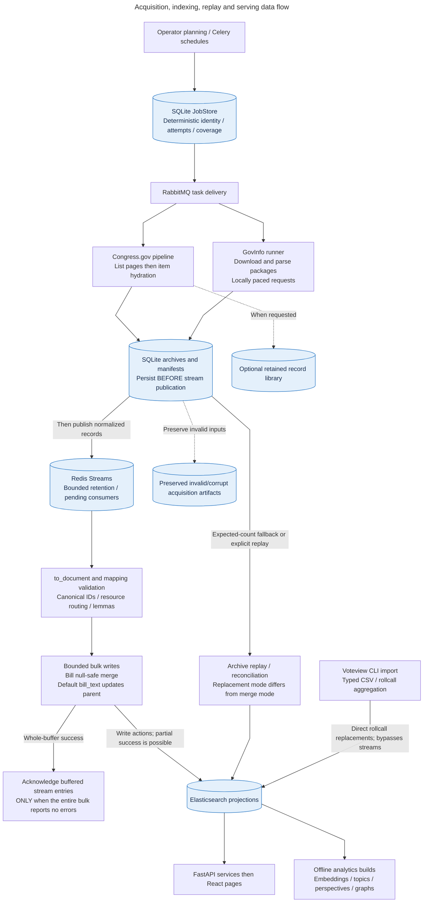
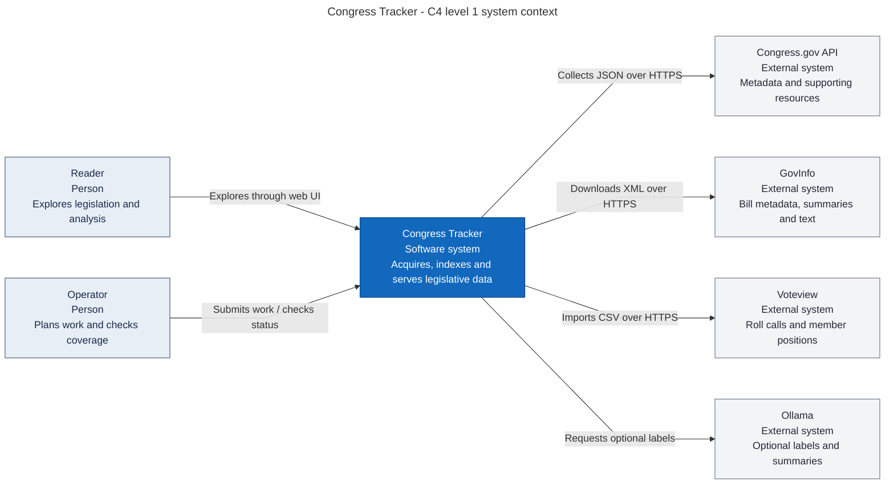
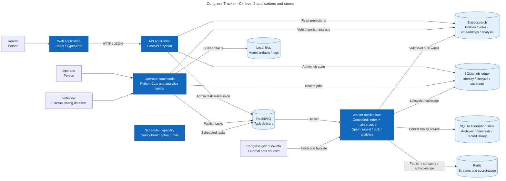

# Visual atlas

Generated from the `.mmd` sources by `uv run python tools/build_documentation.py`.
The diagrams describe implementation boundaries, not measured production
coverage. C4 context, containers, and components are different zoom levels.

## backend-components

[Editable Mermaid source](../diagrams/backend-components.mmd)

## bill-request-sequence

[Editable Mermaid source](../diagrams/bill-request-sequence.mmd)

## data-model

[Editable Mermaid source](../diagrams/data-model.mmd)

## deployment

[Editable Mermaid source](../diagrams/deployment.mmd)

## ingest-dataflow

[Editable Mermaid source](../diagrams/ingest-dataflow.mmd)

## system-context

[Editable Mermaid source](../diagrams/system-context.mmd)

## worker-architecture

[Editable Mermaid source](../../worker-architecture.mmd)

